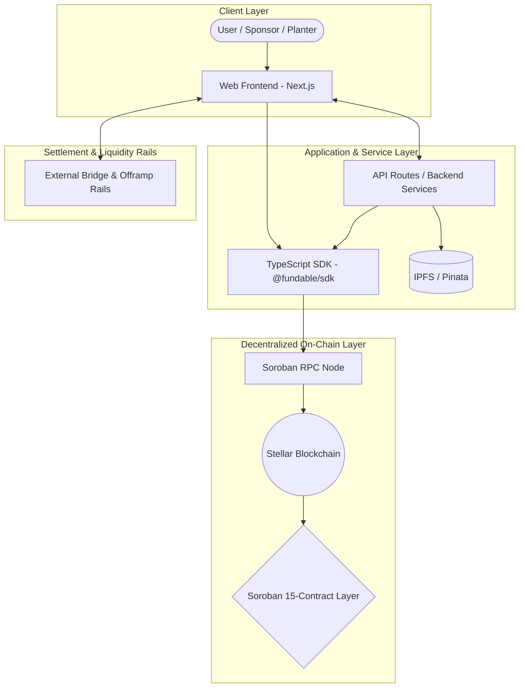
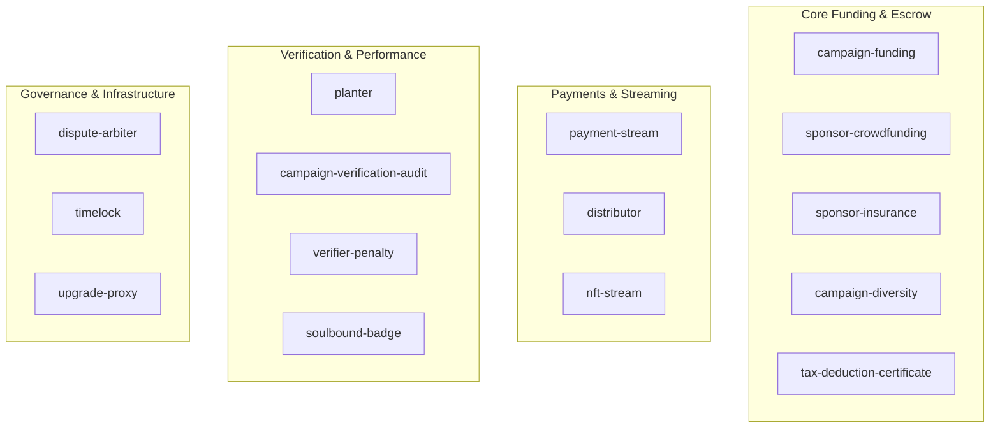
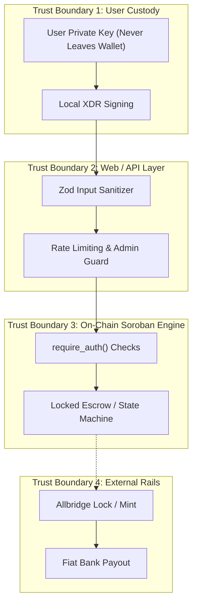
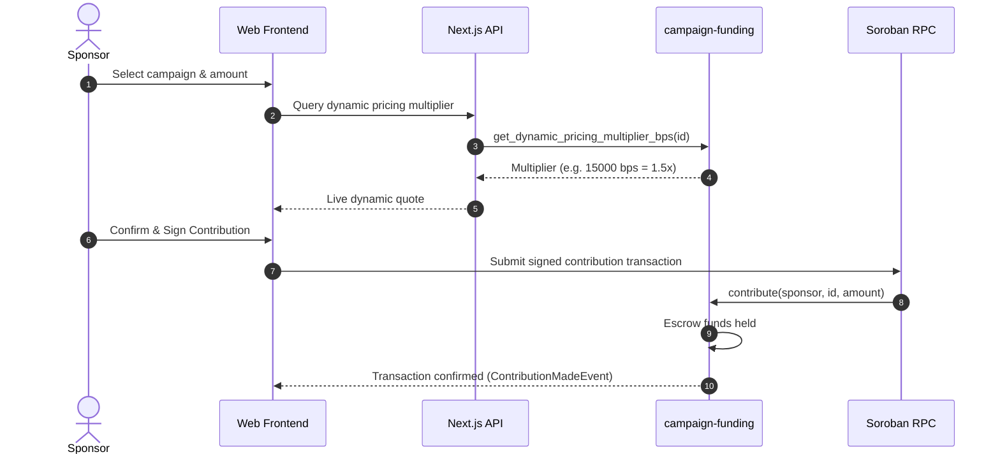
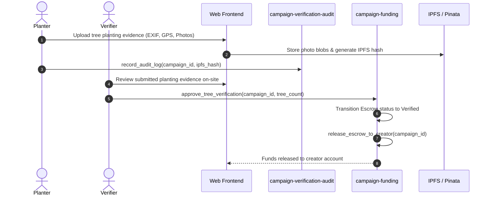
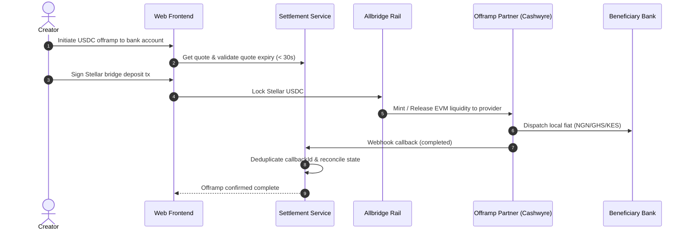

# Fundable Stellar Architecture Guide

This document provides a comprehensive technical guide to the Fundable Stellar platform architecture, spanning the web application, TypeScript SDK, off-chain backend services, and all 15 Soroban smart contracts.

---

## 1. High-Level System Architecture



### Core Layers
1. **Frontend (`apps/web`):** Next.js 15 client providing responsive UI for campaign management, tree planting verification, donor tax certificates, and offramp bank transfers.
2. **TypeScript SDK (`packages/sdk`):** Type-safe library abstracting Soroban contract interaction, transaction assembly, simulation, deterministic contract ID prediction, and polling.
3. **Soroban Smart Contracts (`contracts/*`):** 15 Rust-based Soroban contracts enforcing escrow holds, payment streaming, dynamic pricing, badges, slashing, arbitration, timelocks, and upgrades.
4. **Off-Chain Services & Storage:** Next.js route handlers, background email/push notification workers, IPFS metadata anchoring, and webhook dispatchers.

---

## 2. Smart Contract Inventory (15 Contracts)

The on-chain layer is organized as a Cargo workspace with 15 contracts:



### Detailed Contract Specifications

| # | Workspace Member | Package Name | WASM Artifact | Description & Responsibilities |
|---|------------------|--------------|---------------|--------------------------------|
| 1 | `payment-stream` | `payment-stream` | `payment_stream.wasm` | Manages continuous linear token streaming between senders and recipients with rate-based unlocking, pause, cancel, and protocol fee collection. |
| 2 | `distributor` | `distributor` | `distributor.wasm` | Executes one-to-many token distributions with support for equal shares or weighted percentage splits, with automated fee deduction. |
| 3 | `nft-stream` | `nft-stream` | `nft_stream.wasm` | Enables streaming non-fungible tokens released according to time schedules or verified campaign milestone completions. |
| 4 | `campaign-funding` | `campaign-funding` | `campaign_funding.wasm` | Orchestrates crowdfunding campaigns, milestone escrow holds, dynamic surge pricing algorithms, planter allocations, and verified fund releases. |
| 5 | `soulbound-badge` | `soulbound-badge` | `soulbound_badge.wasm` | Issues non-transferable, identity-bound credential badges recognizing verified tree planters, milestone achievements, and high-impact donors. |
| 6 | `verifier-penalty` | `stellar-client-os-verifier-penalty` | `stellar_client_os_verifier_penalty.wasm` | Manages collateral staking and slashing penalties for campaign verification oracles who breach audit SLAs or submit fraudulent verifications. |
| 7 | `planter` | `planter` | `planter.wasm` | Maintains registered planter performance records, assigned planting sites, work proofs, and reward distribution eligibility. |
| 8 | `campaign-verification-audit` | `campaign-verification-audit` | `campaign_verification_audit.wasm` | Append-only, tamper-proof on-chain log of all site verification records, photo hashes, and auditor attestations. |
| 9 | `dispute-arbiter` | `stellar-client-os-dispute-arbiter` | `stellar_client_os_dispute_arbiter.wasm` | Multi-party dispute resolution engine capable of freezing escrow releases and adjudicating campaign milestone disputes via arbiter voting. |
| 10 | `timelock` | `timelock` | `timelock.wasm` | Enforces mandatory time delays on sensitive protocol administrative actions, allowing audit and governance cancellation prior to execution. |
| 11 | `upgrade-proxy` | `upgrade-proxy` | `upgrade_proxy.wasm` | UUPS-compatible upgrade proxy enabling zero-downtime Soroban contract logic upgrades while maintaining persistent storage state. |
| 12 | `sponsor-crowdfunding` | `sponsor-crowdfunding` | `sponsor_crowdfunding.wasm` | Implements quadratic funding and corporate matching grant pools for civic and environmental reforestation projects. |
| 13 | `sponsor-insurance` | `sponsor-insurance` | `sponsor_insurance.wasm` | Tree-loss protection and mortality insurance pool safeguarding sponsors against climate and environmental risks within a 2-year window. |
| 14 | `campaign-diversity` | `campaign-diversity` | `campaign_diversity.wasm` | Calculates ecological biodiversity indices (Simpson / Shannon), tracks native species ratios, and adjusts campaign incentive multipliers. |
| 15 | `tax-deduction-certificate` | `tax-deduction-certificate` | `tax_deduction_certificate.wasm` | Issues verifiable non-profit tax exemption certificates for charitable campaign contributions tied directly to on-chain transaction hashes. |

---

## 3. API Boundaries

The architecture maintains strict boundaries across communication interfaces:

### 1. Web Frontend <-> Next.js Route Handlers
- **Protocol:** HTTP/1.1 and HTTP/2 JSON REST & GraphQL (`/api/*`).
- **Authentication:** Stellar wallet cryptographic signatures verified via `@creit.tech/stellar-wallets-kit` and freighter extensions; API rate limits enforced by Redis / in-memory sliding window counters.
- **Payload Validation:** Strict Zod schemas on all API inputs before service-layer execution.

### 2. Service Layer <-> Webhook Delivery Subsystem
- **Endpoints:** `/api/webhooks/subscriptions`, `/api/webhooks/trigger`.
- **Integrity:** Payloads signed with HMAC-SHA256 (`X-Webhook-Signature`).
- **Idempotency:** Stable event identities (`eventId`, `verificationId`, `txHash`) deduplicated per subscriber.
- **Resilience:** Automatic exponential backoff retries with dead-letter queue (DLQ) logging.

### 3. TypeScript SDK <-> Soroban RPC Node
- **Protocol:** JSON-RPC over HTTPS (`https://soroban-testnet.stellar.org` or local network).
- **Transaction Assembly:** Builds XDR envelopes, sets sequence numbers, and manages resource footprint simulation.
- **Fee Buffer:** Applies a 1.2x safety multiplier on simulated resource fees to prevent mempool rejection under surge conditions.
- **Polling:** Transaction status polled via `getTransaction` with configurable timeouts and backoff intervals.

---

## 4. Trust Boundaries & Security Model



### Trust Boundary Principles
1. **Zero Private-Key Exposure:** The frontend and backend never handle or store user secret keys. All transaction authorization is performed client-side by wallet software.
2. **On-Chain Authorization (`require_auth`):** Every mutating contract method verifies that the caller address authenticated the invocation. Contracts reject spoofed transactions immediately at the Soroban host boundary.
3. **Escrow Isolation:** Sponsor funds are held in campaign-specific escrow accounts. Funds cannot be released to campaign creators until authorized verifiers approve milestone proof attestations.
4. **Oracle & Verifier Slashing:** Verifiers must post collateral in `verifier-penalty`. Malicious, delinquent, or fraudulent attestations result in slashed stake and dispute arbitration.
5. **Bridge & Offramp Settlement:** Cross-chain bridge quotes enforce strict TTL windows (30s rate preview, 10m order expiry). Webhooks from fiat settlement providers require signature validation and strict idempotency deduplication to prevent replay exploits.

---

## 5. Current System Data Flows

### Flow 1: Campaign Creation, Dynamic Pricing & Funding


### Flow 2: Planting Verification, Audit Log & Escrow Release


### Flow 3: Bridge & Offramp Fiat Settlement


---

## 6. Architecture Maintenance & CI Verification

To guarantee that this architecture guide never diverges from the evolving contract workspace:

1. **Workspace Sync Rule:** Any addition, rename, or removal of a member in `contracts/Cargo.toml` must be matched by a corresponding entry in Section 2 above.
2. **Automated Verification:** The project includes an automated test check in `apps/web/src/__tests__/architecture-docs.test.ts` that:
   - Reads `contracts/Cargo.toml` to extract all active contract members.
   - Asserts that every contract member is documented in `docs/architecture.md`.
   - Validates that artifact WASM names and trust boundary sections are present.
3. **Execution Command:**
   ```bash
   pnpm --filter @fundable/web test src/__tests__/architecture-docs.test.ts
   ```
   This command is run in CI to block pull requests with undocumented contracts.
