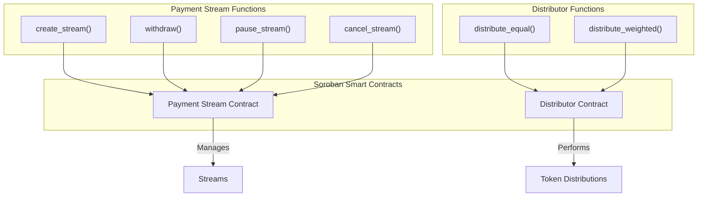

# Architecture

This document provides a high-level overview of the Fundable Stellar project's architecture, which is composed of three main parts: a web frontend, a TypeScript SDK, and Soroban smart contracts.

## High-Level Architecture

The following diagram illustrates the interaction between the main components of the system:

```mermaid
graph TD
    A[User] --> B{Frontend (Next.js)}
    B <--> C{Backend (Node.js API)}
    B --> SDK{SDK (@fundable/sdk)}
    C --> SDK
    SDK --> D{Soroban Smart Contracts}
    D --> E((Stellar Blockchain))
    B --> F[(IPFS - Decentralized Storage)]
    C --> F

    subgraph "Client-Side"
        A
        B
    end

    subgraph "Off-Chain / API"
        C
        SDK
    end

    subgraph "Decentralized Network"
        D
        E
        F
    end
```

### Components

-   **Frontend (Next.js):** The user-facing web application that allows users to interact with the Fundable Protocol.
-   **SDK (@fundable/sdk):** A TypeScript library that abstracts the communication with the Soroban smart contracts, providing a simple API for the frontend.
-   **Soroban Smart Contracts:** The on-chain logic that governs payment streams and token distribution.
-   **Stellar Blockchain:** The underlying blockchain where the smart contracts are deployed and transactions are recorded.

## Contract Architecture

The smart contract layer is composed of two main contracts, organized as a Cargo workspace.



### Contracts

-   **Payment Stream Contract:** Manages the lifecycle of payment streams, including creation, withdrawal, pausing, and cancellation.
-   **Distributor Contract:** Handles the distribution of tokens to multiple recipients, with support for both equal and weighted distributions.

## Security, Observability & Operational Resilience

The platform adheres to enterprise security, observability, and operational data continuity standards:

- **Distributed Tracing & Correlation:** Propagates W3C traceparent and request correlation across API endpoints, Stellar RPC/Horizon calls, and webhook notifications while redacting wallet secrets, mnemonics, and personal identifiers. See [Observability & Tracing](./observability-tracing.md).
- **Service Level Objectives (SLOs):** Defines 99.9% / 99.5% availability and latency targets across critical flows (reads, submission, webhooks, sync) with multi-window burn-rate alerting. See [SLO & Alert Thresholds](./slo-and-alert-thresholds.md) and [SLO Runbook](./runbooks/slo-burn-rate.md).
- **Incident Response & Key Compromise:** Structured operational runbooks for emergency containment, on-chain multi-sig signer demotion, zero-downtime dual-secret rotation, and tabletop exercises. See [Incident Response Runbook](./runbooks/incident-response.md) and [Key Compromise Runbook](./runbooks/key-compromise.md).
- **Backup & Isolated Restore Continuity:** Cryptographic AES-256-GCM operational data snapshots, grandfather-father-son retention, and isolated restore drills enforcing RPO <= 15m and RTO <= 30m. See [Backup & Restore Policy](./backup-and-restore-policy.md) and [Restore Drill Runbook](./runbooks/backup-restore-drill.md).
