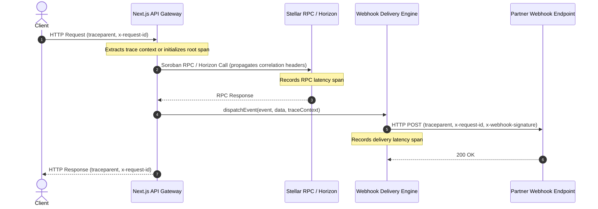

# Distributed Tracing & Telemetry Sanitization

This document outlines the distributed tracing and telemetry architecture implemented across Fundable's API, Stellar RPC, and webhook systems, along with the strict privacy and security rules governing sensitive data exclusion.

---

## 🌐 Overview & Correlation Flow

Fundable propagates distributed trace identifiers and latency spans across all external and internal communication boundaries using standard **W3C Trace Context** (`traceparent`) and request correlation headers.



---

## 🏷️ Standard Propagated Headers

| Header | Format / Standard | Purpose |
| :--- | :--- | :--- |
| `traceparent` | `00-{traceId}-{spanId}-{flags}` (W3C) | Standard 32-hex trace ID and 16-hex span ID linking distributed hops. |
| `x-request-id` | `req_{hex}` | Unique request identifier for log indexing and tracing. |
| `x-trace-id` | `32-char hex` | Direct trace identifier matching the active trace ID. |
| `x-correlation-id` | `string` | Correlation identifier preserved across multi-step business transactions. |

---

## 🛡️ Sensitive Data Exclusion & Redaction Policy

To prevent sensitive cryptographic material or personally identifiable information from leaking into telemetry, distributed spans, Sentry alerts, dead-letter queues, or application logs, all attributes and payloads are passed through the strict sanitization engine (`apps/web/src/lib/tracing/sanitizer.ts`).

### Automatically Redacted Items

1. **Wallet Payloads & Keys:**
   - Stellar Secret Keys (`S[A-Z0-9]{55}`) are unconditionally replaced with `[REDACTED_SECRET_KEY]`.
   - Seed phrases, mnemonics, private keys, and wallet signing credentials.
   - Stellar Public Keys (`G[A-Z0-9]{55}`) are truncated to `G123...4567` (or fully masked when `maskPublicKeys: true`) to prevent identity correlation.
2. **Secrets & Tokens:**
   - `Authorization: Bearer <token>` headers are replaced with `Bearer [REDACTED_TOKEN]`.
   - Cookie headers are replaced with `[REDACTED_HEADER]`.
   - Query string credentials (`?apiKey=...&token=...`) are replaced with `[REDACTED]`.
   - Properties named `secret`, `password`, `token`, `api_key`, `webhook_secret`, `private_key` are replaced with `[REDACTED_SECRET]`.
3. **Personal Identifiers (PII):**
   - Email addresses (`[REDACTED_EMAIL]`).
   - Phone numbers (`[REDACTED_PHONE]`).
   - SSN / Tax IDs (`[REDACTED_TAX_ID]`).

---

## 💻 Developer Usage

### 1. Wrapping Next.js API Routes
```typescript
import { withApiTracing } from '@/lib/tracing';

export const GET = withApiTracing('campaigns.list', async (req) => {
  // Trace context is automatically active in this scope
  return Response.json({ campaigns: [] });
});
```

### 2. Manual Span Recording
```typescript
import { withSpan } from '@/lib/tracing';

const result = await withSpan('stellar.rpc.simulateTransaction', async (span) => {
  span.setAttribute('rpc.method', 'simulateTransaction');
  return await rpcServer.simulateTransaction(tx);
});
```

### 3. Webhook Delivery Tracing
When calling `webhookService.dispatchEvent()`, the active trace context is automatically inherited, or a new correlated context is generated:
```typescript
await webhookService.dispatchEvent('stream.created', payload);
```
Outgoing webhook HTTP requests will include `traceparent`, `x-request-id`, and `x-correlation-id`.

---

## 🔄 Compatibility & Migration Implications

- **Backwards Compatibility:** All trace header additions are non-breaking and fully optional for incoming clients.
- **Webhook Receivers:** Partner endpoints receiving webhooks will see the new `traceparent`, `X-Request-Id`, and `X-Correlation-Id` headers. Existing signature verification (`X-Webhook-Signature`) is computed over the payload body and timestamp only and remains 100% compatible.
