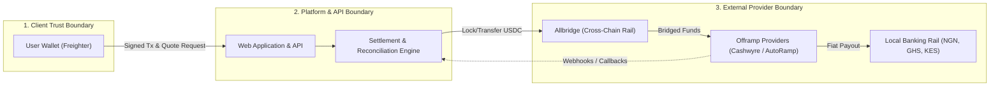
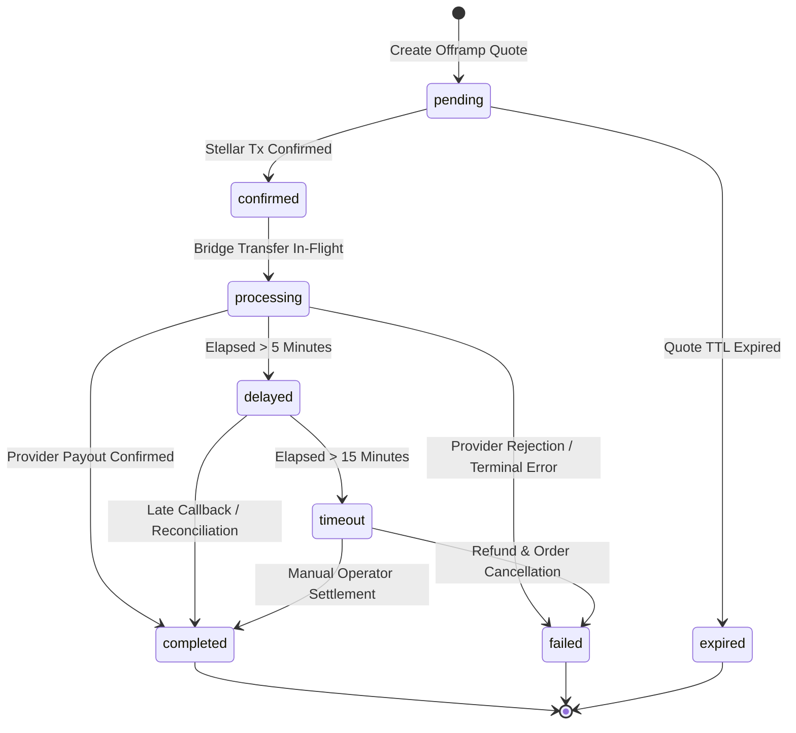

# Bridge and Offramp Settlement Trust Boundaries

This specification defines the security architecture, trust boundaries, state machine, idempotency mechanisms, and operational reconciliation procedures for cross-chain bridging and offramp fiat settlement in the Fundable Stellar platform.

---

## 1. Architectural Trust Boundaries

The offramp flow spans three distinct trust domains:



### Boundary 1: Client <-> Platform
- **Trust Assumption:** The client (browser and user wallet) is untrusted. Inputs (amounts, recipient account numbers, bank codes) cannot be assumed valid.
- **Enforcement:**
  - Quote Expiry: Live rates expire within `QUOTE_TTL_MS` (30s) and created orders expire within `OFFRAMP_QUOTE_TTL_MS` (10m). Expired quotes are strictly rejected (`QuoteExpiredError`) to eliminate slippage and front-running arbitrage.
  - Daily Tier Limits: User transaction volume is checked against tier caps before signature submission.
  - Local Custody: Private keys never touch platform servers; transactions are signed locally via Stellar wallet standard envelopes.

### Boundary 2: Platform <-> Bridge (Allbridge)
- **Trust Assumption:** Cross-chain bridging across Stellar and EVM (Polygon) networks involves latency and potential network reorgs or RPC stalls.
- **Enforcement:**
  - Bridge Timeout SLA: Cross-chain transfers must resolve within `BRIDGE_TIMEOUT_MS` (15 minutes).
  - Timeout Escalation: Transfers pending longer than 15 minutes transition to `timeout` / `delayed`, triggering automated alerting and manual reconciliation tracking.

### Boundary 3: Platform <-> Offramp Providers (Cashwyre / AutoRamp)
- **Trust Assumption:** Provider callbacks arrive asynchronously over public internet rails and may suffer from packet duplication, retries, network latency, or out-of-order delivery.
- **Enforcement:**
  - Idempotency & Deduplication: Every callback includes a unique `callbackId` and `transactionReference`. Callbacks are deduplicated; replays are acknowledged without re-executing state changes or double-crediting.
  - State Locking: Once a settlement reaches a terminal state (`completed` or `failed`), it cannot be overwritten by out-of-order or delayed messages.
  - Delayed Settlement Reconciliation: Settlements delayed past `DELAYED_SETTLEMENT_THRESHOLD_MS` (5 minutes) enter the delayed queue for automated or operator-driven reconciliation.

---

## 2. Settlement State Machine



### Status Descriptions

| Status | Type | Description |
|--------|------|-------------|
| `pending` | In-Flight | Quote accepted; awaiting user signature and initial bridge execution. |
| `confirmed` | In-Flight | Stellar transaction confirmed on-chain; funds locked for cross-chain transfer. |
| `processing` | In-Flight | Bridge transfer or fiat bank dispatch actively running with provider. |
| `delayed` | In-Flight | Settlement has exceeded standard SLA (5 mins); active monitoring initiated. |
| `timeout` | Alert / Review | Bridge SLA exceeded (15 mins); queued for automated or operator reconciliation. |
| `completed` | Terminal | Fiat confirmed delivered to beneficiary's verified bank account. |
| `failed` | Terminal | Permanent provider failure, invalid account, compliance hold, or canceled. |
| `expired` | Terminal | Quote validity window elapsed prior to transaction initiation. |

---

## 3. Idempotency & Duplicate Callback Handling

To guarantee that network retries or replay attacks never cause double payouts or state corruption:

1. **Callback Registration:**
   The `OfframpSettlementService` tracks all processed `callbackId`s in memory and persistence.
2. **Replay Rejection:**
   When an incoming callback carries an already recorded `callbackId`, the system returns:
   ```json
   {
     "success": true,
     "data": {
       "actionTaken": "duplicate_ignored",
       "isDuplicate": true,
       "currentStatus": "completed"
     }
   }
   ```
3. **Terminal Immutability:**
   A settlement in status `completed` ignores late non-terminal callbacks (e.g. an out-of-order `processing` webhook).

---

## 4. Delayed Settlement & Reconciliation Operations

### Detection
Any settlement where `status === "processing"` or `status === "confirmed"` that exceeds 5 minutes without a terminal webhook is flagged as `delayed`.

### Operator Reconciliation API

- **List Delayed Settlements:**
  ```http
  GET /api/offramp/reconcile
  ```
  Returns count and details of all settlements exceeding SLA thresholds.

- **Trigger Reconciliation:**
  ```http
  POST /api/offramp/reconcile
  Content-Type: application/json

  {
    "transactionReference": "ref-12345",
    "targetStatus": "completed",
    "message": "Verified receipt with partner banking portal"
  }
  ```

### Operator Runbook for Provider Failures
1. **Transient Network Failures:** Handled automatically via exponential backoff in `apps/web/src/utils/retry.ts`.
2. **Invalid Account Details (`invalid_bank_details`):**
   - Settlement transitions to `failed`.
   - Contact beneficiary to verify bank code and account number.
   - If funds remain locked in bridge or provider deposit address, initiate refund flow.
3. **Compliance Hold (`compliance_hold`):**
   - Query provider support portal for required AML/KYC documentation.
   - Hold transaction in `delayed` status until compliance release.

---

## 5. Compatibility & Migration Implications

- **API Compatibility:** Existing client integrations calling `getQuoteStatus` or `createOfframp` are non-breaking. The addition of `"timeout"` and `"delayed"` statuses is fully backward-compatible with the UI tracker.
- **Database / Storage Migration:** Settlement records extend existing quote structures with `failureCategory`, `reconciledAt`, and `processedCallbacks`. In environments using persistent databases (PostgreSQL/Redis), add nullable columns for these fields.
