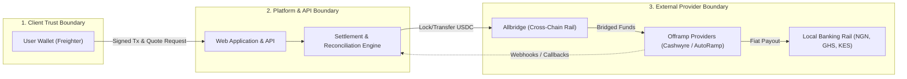
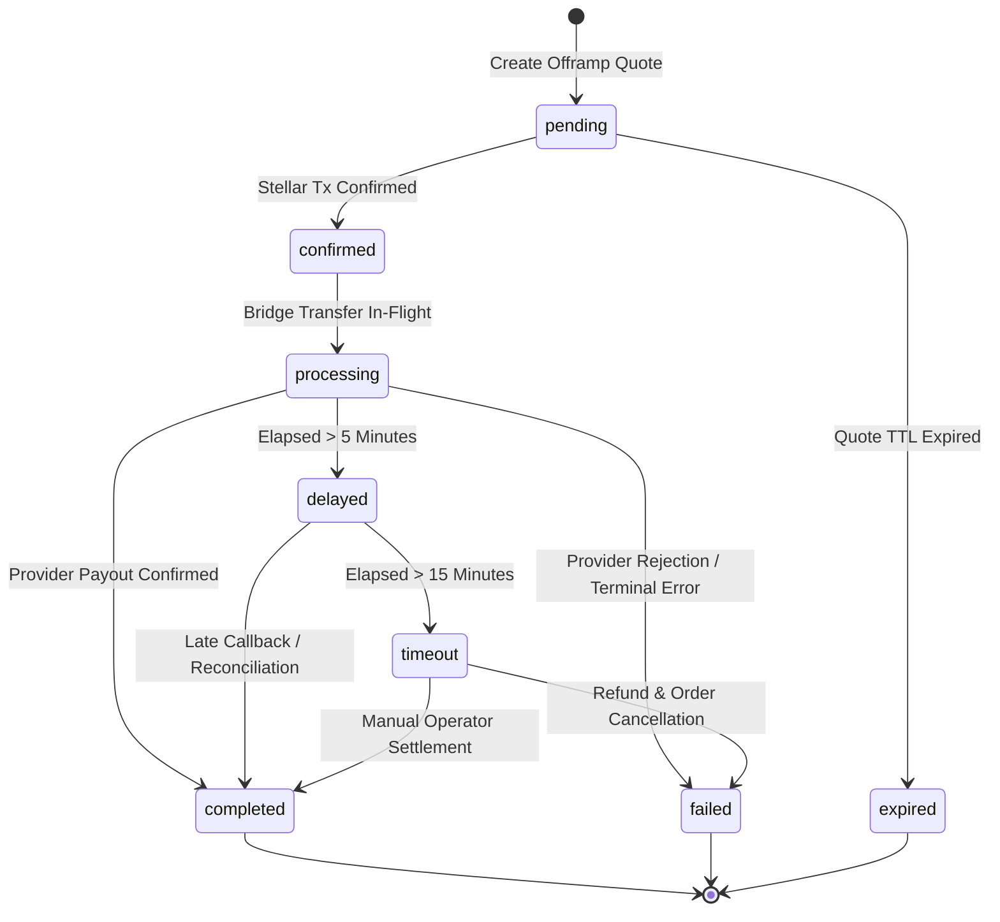

# Bridge and Offramp Settlement Trust Boundaries

This specification defines the security architecture, trust boundaries, state machine, idempotency mechanisms, and operational reconciliation procedures for cross-chain bridging and offramp fiat settlement in the Fundable Stellar platform.

---

## 1. Architectural Trust Boundaries

The offramp flow spans three distinct trust domains:



### Boundary 1: Client <-> Platform
- **Trust Assumption:** The client (browser and user wallet) is untrusted. Inputs (amounts, recipient account numbers, bank codes) cannot be assumed valid.
- **Enforcement:**
  - Quote Expiry: Live rates expire within `QUOTE_TTL_MS` (30s) and created orders expire within `OFFRAMP_QUOTE_TTL_MS` (10m). Expired quotes are strictly rejected (`QuoteExpiredError`) to eliminate slippage and front-running arbitrage.
  - Daily Tier Limits: User transaction volume is checked against tier caps before signature submission.
  - Local Custody: Private keys never touch platform servers; transactions are signed locally via Stellar wallet standard envelopes.

### Boundary 2: Platform <-> Bridge (Allbridge)
- **Trust Assumption:** Cross-chain bridging across Stellar and EVM (Polygon) networks involves latency and potential network reorgs or RPC stalls.
- **Enforcement:**
  - Bridge Timeout SLA: Cross-chain transfers must resolve within `BRIDGE_TIMEOUT_MS` (15 minutes).
  - Timeout Escalation: Transfers pending longer than 15 minutes transition to `timeout` / `delayed`, triggering automated alerting and manual reconciliation tracking.

### Boundary 3: Platform <-> Offramp Providers (Cashwyre / AutoRamp)
- **Trust Assumption:** Provider callbacks arrive asynchronously over public internet rails and may suffer from packet duplication, retries, network latency, or out-of-order delivery. Additionally, callbacks may be subject to replay attacks, cross-network attacks, and unauthorized submissions.
- **Enforcement (Issue #279):**
  - **Origin Validation:** HMAC SHA-256 signature verification using shared webhook secret. Signatures are verified using timing-safe comparison to prevent timing attacks.
  - **Expiry Validation:** Callback timestamps must be within 5 minutes of current time (with 30-second clock skew tolerance). Older callbacks are rejected to prevent replay attacks.
  - **Network Validation:** Callbacks must include network passphrase or network name matching the configured Stellar network (testnet/mainnet). Cross-network callbacks are rejected.
  - **State Transition Validation:** Validates that status transitions follow the allowed state machine. Terminal states (`completed`, `failed`, `expired`) cannot be overwritten.
  - **Idempotency & Deduplication:** Every callback includes a unique `callbackId` and `transactionReference`. Callbacks are deduplicated; replays are acknowledged without re-executing state changes or double-crediting.
  - **State Locking:** Once a settlement reaches a terminal state, it cannot be overwritten by out-of-order or delayed messages.
  - **Delayed Settlement Reconciliation:** Settlements delayed past `DELAYED_SETTLEMENT_THRESHOLD_MS` (5 minutes) enter the delayed queue for automated or operator-driven reconciliation.

---

## 2. Settlement State Machine



### Status Descriptions

| Status | Type | Description |
|--------|------|-------------|
| `pending` | In-Flight | Quote accepted; awaiting user signature and initial bridge execution. |
| `confirmed` | In-Flight | Stellar transaction confirmed on-chain; funds locked for cross-chain transfer. |
| `processing` | In-Flight | Bridge transfer or fiat bank dispatch actively running with provider. |
| `delayed` | In-Flight | Settlement has exceeded standard SLA (5 mins); active monitoring initiated. |
| `timeout` | Alert / Review | Bridge SLA exceeded (15 mins); queued for automated or operator reconciliation. |
| `completed` | Terminal | Fiat confirmed delivered to beneficiary's verified bank account. |
| `failed` | Terminal | Permanent provider failure, invalid account, compliance hold, or canceled. |
| `expired` | Terminal | Quote validity window elapsed prior to transaction initiation. |

---

## 3. Callback Security & Validation (Issue #279)

To protect against replay attacks, cross-network attacks, and unauthorized callbacks, all provider callbacks undergo comprehensive validation before processing:

### 3.1 Validation Layers

#### Layer 1: Origin Validation (HMAC Signature)
Every callback must include an HMAC SHA-256 signature computed over the canonical payload:
```json
{
  "callbackId": "cb-001",
  "transactionReference": "ref-12345",
  "providerId": "cashwyre",
  "status": "completed",
  "timestamp": "2024-01-15T10:30:00.000Z"
}
```

**Signature Generation:**
```
signature = HMAC-SHA256(webhook_secret, canonical_payload)
```

**Validation Rules:**
- Signatures are verified using timing-safe comparison to prevent timing attacks
- Missing signatures are rejected in production mode
- Invalid signatures result in HTTP 401 Unauthorized

#### Layer 2: Expiry Validation (Timestamp Age)
Callback timestamps must be recent to prevent replay attacks:
- **Maximum Age:** 5 minutes (300 seconds)
- **Clock Skew Tolerance:** 30 seconds
- **Validation Logic:**
  ```
  age = current_time - callback_timestamp
  valid = (age <= 300s) AND (age >= -30s)
  ```

**Rejection Scenarios:**
- Timestamp older than 5 minutes → HTTP 400 (CALLBACK_EXPIRED)
- Timestamp in future beyond tolerance → HTTP 400 (CALLBACK_FROM_FUTURE)

#### Layer 3: Network Validation
Callbacks must specify the Stellar network and match the configured environment:
- **Network Passphrase:** e.g., "Test SDF Network ; September 2015"
- **Network Name:** "testnet" or "mainnet"

**Validation Rules:**
- At least one network identifier required in production
- Network must match `NEXT_PUBLIC_NETWORK_PASSPHRASE` or `NEXT_PUBLIC_STELLAR_NETWORK`
- Cross-network callbacks result in HTTP 400 (NETWORK_MISMATCH)

#### Layer 4: State Transition Validation
State transitions must follow the allowed state machine:

| Current Status | Allowed Next States |
|----------------|---------------------|
| `pending` | `processing`, `confirmed`, `expired`, `failed` |
| `confirmed` | `processing`, `completed`, `failed`, `delayed` |
| `processing` | `completed`, `failed`, `delayed`, `timeout` |
| `delayed` | `completed`, `failed`, `timeout` |
| `timeout` | `completed`, `failed` |
| `completed` | *(terminal - no transitions)* |
| `failed` | *(terminal - no transitions)* |
| `expired` | *(terminal - no transitions)* |

**Terminal State Protection:**
- Once a settlement reaches `completed`, `failed`, or `expired`, it cannot transition to any other state
- Duplicate callbacks of the same terminal state are allowed (idempotent)
- Invalid transitions result in HTTP 409 Conflict (INVALID_STATE_TRANSITION)

### 3.2 Configuration

**Environment Variables:**
```bash
# Webhook signing secret (required in production)
OFFRAMP_WEBHOOK_SECRET=your-secret-key-here

# Network configuration
NEXT_PUBLIC_NETWORK_PASSPHRASE="Test SDF Network ; September 2015"
NEXT_PUBLIC_STELLAR_NETWORK=testnet
```

**Validation Configuration:**
```typescript
{
  MAX_CALLBACK_AGE_MS: 5 * 60 * 1000,      // 5 minutes
  CLOCK_SKEW_TOLERANCE_MS: 30 * 1000,      // 30 seconds
  NETWORK_PASSPHRASE: process.env.NEXT_PUBLIC_NETWORK_PASSPHRASE,
  WEBHOOK_SECRET_ENV_KEY: "OFFRAMP_WEBHOOK_SECRET"
}
```

### 3.3 Provider Integration

**Callback Payload Format:**
```json
{
  "callbackId": "cb-unique-001",
  "transactionReference": "ref-12345",
  "providerId": "cashwyre",
  "status": "completed",
  "timestamp": "2024-01-15T10:30:00.000Z",
  "signature": "a3f5b2c8d1e9f7a6b4c3d2e1f0a9b8c7d6e5f4a3b2c1d0e9f8a7b6c5d4e3f2a1",
  "networkPassphrase": "Test SDF Network ; September 2015",
  "network": "testnet",
  "providerStatus": "SETTLED",
  "message": "Payout completed successfully"
}
```

**Required Fields:**
- `callbackId`: Unique identifier for idempotency
- `transactionReference`: Links callback to settlement
- `providerId`: Provider identifier (cashwyre, autoramp)
- `status`: Payout status (pending, processing, completed, failed, etc.)
- `timestamp`: ISO 8601 timestamp
- `signature`: HMAC SHA-256 signature (required in production)
- `networkPassphrase` or `network`: Network identifier (required in production)

### 3.4 Error Responses

| Error Code | HTTP Status | Description |
|------------|-------------|-------------|
| `MISSING_SIGNATURE` | 401 | Signature required in production |
| `INVALID_SIGNATURE` | 401 | Signature verification failed |
| `SIGNATURE_VERIFICATION_ERROR` | 500 | Internal signature verification error |
| `MISSING_TIMESTAMP` | 400 | Timestamp field required |
| `INVALID_TIMESTAMP` | 400 | Timestamp not valid ISO 8601 |
| `CALLBACK_EXPIRED` | 400 | Timestamp older than 5 minutes |
| `CALLBACK_FROM_FUTURE` | 400 | Timestamp in future beyond tolerance |
| `MISSING_NETWORK` | 400 | Network identifier required |
| `NETWORK_MISMATCH` | 400 | Network doesn't match configuration |
| `INVALID_STATE_TRANSITION` | 409 | State transition not allowed |

**Example Error Response:**
```json
{
  "success": false,
  "error": "Callback timestamp is too old (age: 420s, max: 300s)",
  "code": "CALLBACK_EXPIRED"
}
```

---

## 4. Idempotency & Duplicate Callback Handling

To guarantee that network retries or replay attacks never cause double payouts or state corruption:

1. **Callback Registration:**
   The `OfframpSettlementService` tracks all processed `callbackId`s in memory and persistence.
2. **Replay Rejection:**
   When an incoming callback carries an already recorded `callbackId`, the system returns:
   ```json
   {
     "success": true,
     "data": {
       "actionTaken": "duplicate_ignored",
       "isDuplicate": true,
       "currentStatus": "completed"
     }
   }
   ```
3. **Terminal Immutability:**
   A settlement in status `completed` ignores late non-terminal callbacks (e.g. an out-of-order `processing` webhook).

---

## 5. Delayed Settlement & Reconciliation Operations

### Detection
Any settlement where `status === "processing"` or `status === "confirmed"` that exceeds 5 minutes without a terminal webhook is flagged as `delayed`.

### Operator Reconciliation API

- **List Delayed Settlements:**
  ```http
  GET /api/offramp/reconcile
  ```
  Returns count and details of all settlements exceeding SLA thresholds.

- **Trigger Reconciliation:**
  ```http
  POST /api/offramp/reconcile
  Content-Type: application/json

  {
    "transactionReference": "ref-12345",
    "targetStatus": "completed",
    "message": "Verified receipt with partner banking portal"
  }
  ```

### Operator Runbook for Provider Failures
1. **Transient Network Failures:** Handled automatically via exponential backoff in `apps/web/src/utils/retry.ts`.
2. **Invalid Account Details (`invalid_bank_details`):**
   - Settlement transitions to `failed`.
   - Contact beneficiary to verify bank code and account number.
   - If funds remain locked in bridge or provider deposit address, initiate refund flow.
3. **Compliance Hold (`compliance_hold`):**
   - Query provider support portal for required AML/KYC documentation.
   - Hold transaction in `delayed` status until compliance release.

---

## 6. Compatibility & Migration Implications

- **API Compatibility:** Existing client integrations calling `getQuoteStatus` or `createOfframp` are non-breaking. The addition of callback validation (Issue #279) adds optional `signature`, `networkPassphrase`, and `network` fields to callback payloads. Existing callbacks without these fields will work in non-production environments but will be rejected in production for security.
- **Provider Integration:** Offramp providers (Cashwyre, AutoRamp) must update their callback implementations to include:
  - HMAC SHA-256 signatures computed with shared webhook secret
  - Network identifiers (networkPassphrase or network name)
  - Timestamps within 5-minute freshness window
- **Database / Storage Migration:** Settlement records extend existing quote structures with `failureCategory`, `reconciledAt`, and `processedCallbacks`. In environments using persistent databases (PostgreSQL/Redis), add nullable columns for these fields.
- **Configuration:** New environment variables required for production:
  - `OFFRAMP_WEBHOOK_SECRET`: Shared secret for HMAC signature verification
  - `NEXT_PUBLIC_NETWORK_PASSPHRASE`: Expected Stellar network passphrase
  - `NEXT_PUBLIC_STELLAR_NETWORK`: Network name (testnet/mainnet)
